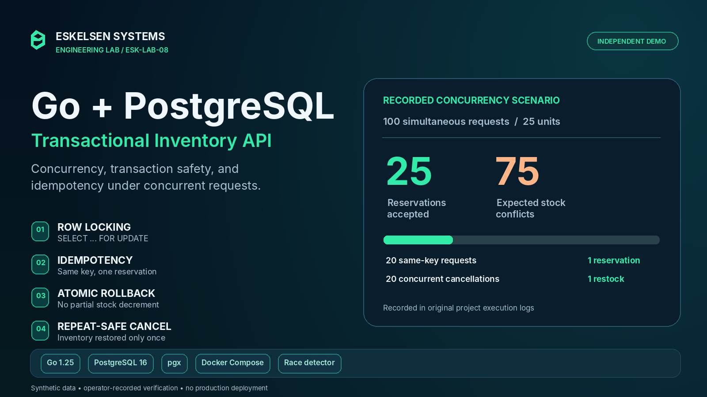

# Go + PostgreSQL Backend Lab

*Illustrative cover using outcomes from original operator-recorded tests; not a live application screenshot.*

Independent engineering demonstration by Eskelsen Systems.

Synthetic inventory API built with Go, net/http, pgx and PostgreSQL.
Demonstrates transactions, row locking, idempotency and cancellation.

## Reported verification results

The following outcomes are preserved from the original project operator's
November 9, 2026 execution logs in `evidence/`; they were not newly
reproduced after the repository module-name change.

- 100 concurrent requests for 25 units: 25 successes and 75 stock conflicts.
- 20 identical requests: one reservation and one stock decrement.
- 20 concurrent cancellations: stock returned once.
- Injected failure: rollback and retry passed.
- Blocked row: deadline interrupted waiting; retry passed.
- SQL inventory checks: zero violations.
- Three recorded runs passed with the Go race detector enabled.
- Compose workflow passed with independent dependency and build caches.

## Scope

Local backend demo using synthetic data. No graphical interface.
No authentication, production deployment or security certification.
These correctness tests are not performance benchmarks.

## Verification workflow

Docker Compose downloads dependencies, initializes an ephemeral database,
builds the code, runs go test -race and executes go vet.
The database publishes no host ports. Go is pinned by image digest.
PostgreSQL uses the postgres:16 tag; tested image identity is in evidence.

The repository import path was aligned to `github.com/r3eskelsen/eskelsen-go-postgres-backend-lab`
for publication. A complete Go 1.25/PostgreSQL rerun is required to
independently revalidate this repackaged source.

See the [architecture diagram](docs/assets/ESK_LAB08_Architecture_Diagram.png),
[setup instructions](docs/SETUP.md), [results](docs/RESULTS.md)
and [limitations](docs/LIMITATIONS.md). Original code is provided for inspection with all rights reserved; see LICENSE. Public execution logs are in evidence/.
